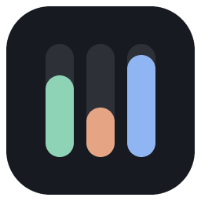

# AI 사용량 전광판 (UsageDesk)

Codex · Claude · Gemini의 남은 사용량(5시간 / 주간)을 PC의 트레이 아이콘과 휴대폰 화면에 보여주는 Windows 프로그램입니다.

## 내려받기

**[최신 버전 내려받기](https://github.com/ku-2x/usage-desk/releases/latest)** 에서 `AI-Usage-Desk-버전.zip`을 받으세요.

## 필요한 것

- Windows 10 또는 11
- Chrome 또는 Edge (Edge는 Windows에 기본으로 있습니다)
- 그 밖에 설치할 것은 없습니다.

## 시작하기

1. 압축을 원하는 곳에 풉니다. 폴더 안의 파일들은 그대로 함께 두세요.
2. `UsageDesk.exe`를 더블클릭합니다.
   "Windows의 PC 보호" 창이 뜨면 [추가 정보] → [실행]을 누르세요. 개인이 만든 프로그램에 공통으로 뜨는 안내입니다.
3. 처음 실행하면 관리 화면이 브라우저에 열립니다. 순서대로 따라 하세요.
   1. 사용할 서비스만 켜기 (구독하지 않는 서비스는 끄세요)
   2. Claude / Gemini 로그인
   3. 휴대폰 연결: 같은 Wi-Fi에 연결한 뒤 QR 코드를 카메라로 비추기
4. 작업 표시줄 오른쪽 아래에 막대 모양 아이콘이 생깁니다. 안 보이면 `^`를 눌러 찾은 뒤 작업 표시줄로 끌어다 놓으세요.

## 화면

### 남은 사용량

서비스마다 5시간 / 주간 남은 양과 초기화까지 남은 시간을 보여줍니다. 20% 이하면 주황, 10% 이하면 빨강으로 바뀝니다.

### 토큰 가치

전광판을 손가락으로 옆으로 밀면(또는 아래쪽 점을 누르면) 나오는 두 번째 화면입니다.
이 PC에서 Claude Code와 Codex로 쓴 토큰을 "API로 썼다면 얼마였을지"로 계산해 보여줍니다.

- 화면의 절반은 오늘 금액과 시간대별로 쌓여 가는 그래프, 나머지 절반은 최근 7일 / 최근 30일 / 전체 기간 금액입니다.
- 화면을 누를 때마다 금액 ↔ 토큰 수로 바뀝니다.
- 실제로 결제되는 금액이 아니라 참고용 추정치입니다.
- 이 PC에 남은 기록만 셉니다. 웹에서 쓴 대화나 Gemini는 포함되지 않습니다.
- 모델 가격표와 환율은 하루에 한 번 인터넷에서 받아 옵니다. 환율을 받지 못하면 달러로 표시됩니다.

## 서비스별 안내

| 서비스 | 필요한 것 |
|---|---|
| Codex | 이 PC에 Codex(CLI)가 설치·로그인되어 있어야 합니다. 없으면 자동으로 꺼집니다. |
| Claude | 이 PC의 Claude Code에 로그인되어 있으면 자동으로 읽습니다. 아니면 관리 화면에서 [Claude 로그인]을 누르세요. |
| Gemini | 관리 화면에서 [Gemini 로그인]을 한 번 해야 합니다. |

로그인은 이 프로그램 전용 브라우저 창에서 이루어지며, 평소 쓰는 브라우저의 로그인과는 따로 보관됩니다.

## 휴대폰에서 안 열릴 때

1. 휴대폰과 PC가 같은 Wi-Fi에 연결되어 있는지 확인하세요.
2. 트레이 아이콘 오른쪽 클릭 → [휴대폰 접속 허용 (방화벽)]을 실행하세요.
3. 회사·카페·공용 Wi-Fi는 기기끼리의 연결을 막는 경우가 많습니다. 휴대폰 핫스팟이나 집 공유기에서 시도해보세요.
4. PC가 절전 상태면 갱신이 멈춥니다.

## 알아둘 점

- 내 설정과 로그인 정보는 프로그램 폴더가 아니라 `%LOCALAPPDATA%\AIUsageDesk`에 저장됩니다. 완전히 지우려면 프로그램을 종료한 뒤 그 폴더를 삭제하세요.
- 휴대폰에는 사용량 숫자, 초기화 시각, 날짜별 토큰 수와 환산 금액만 전달됩니다. 쿠키·페이지 내용·비밀번호·대화 내용은 보내지 않습니다.
- 같은 네트워크 안에서만 쓰는 용도입니다. 공유기에서 외부로 포트를 열지 마세요.
- 각 서비스의 화면이 바뀌면 값을 읽지 못해 "확인 불가"로 표시될 수 있습니다.
- OpenAI, Anthropic, Google과 관계없는 개인 제작 프로그램입니다.

zip에 함께 들어 있는 다른 프로그램과 아이콘의 출처는 [THIRD_PARTY_NOTICES.md](THIRD_PARTY_NOTICES.md)에 있습니다.
